# Microsoft Entra ID: Joiner / Mover / Leaver Lab

A hands-on identity and access management (IAM) lab built in a free Microsoft Entra ID tenant. I set up a fictional hotel company, **Aerospace Hotels**, and worked through the full user lifecycle: onboarding a new hire, moving an employee between departments, and offboarding a departing worker.

**Built by:** Armonn R. Chavez
**Goal:** Practice the account and access tasks that help desk and IAM teams handle every day, using group-based access and least privilege.

> Aerospace Hotels is fictional. This is a lab tenant on the default onmicrosoft.com domain.

---

## Skills Demonstrated

- User provisioning and deprovisioning in Microsoft Entra ID
- Group-based access control with department security groups
- Least privilege: removing old access before granting new access
- Forced password change at first sign-in
- MFA enforcement through security defaults
- Offboarding: block sign-in, revoke sessions, reset password, remove access
- Verifying changes and building a proof trail with audit logs

---

## Phase 1: Tenant Setup

- Created an Entra ID Free tenant and renamed it **Aerospace Hotels (Lab)**
- Confirmed **security defaults** are enabled, which requires MFA registration for all users
- Created six department security groups:

| Group | Purpose |
|---|---|
| Front Desk | Front desk agents and supervisors |
| Housekeeping | Housekeeping staff and supervisors |
| Food & Beverage | Restaurant, bar, and room service staff |
| HR | Human Resources |
| Finance | Accounting and payroll |
| IT | IT support and administration |

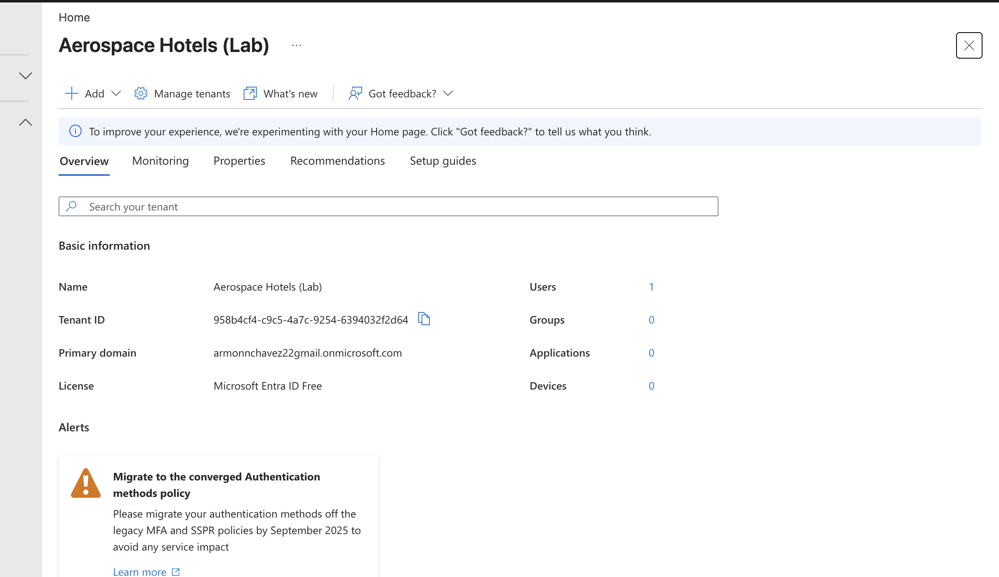
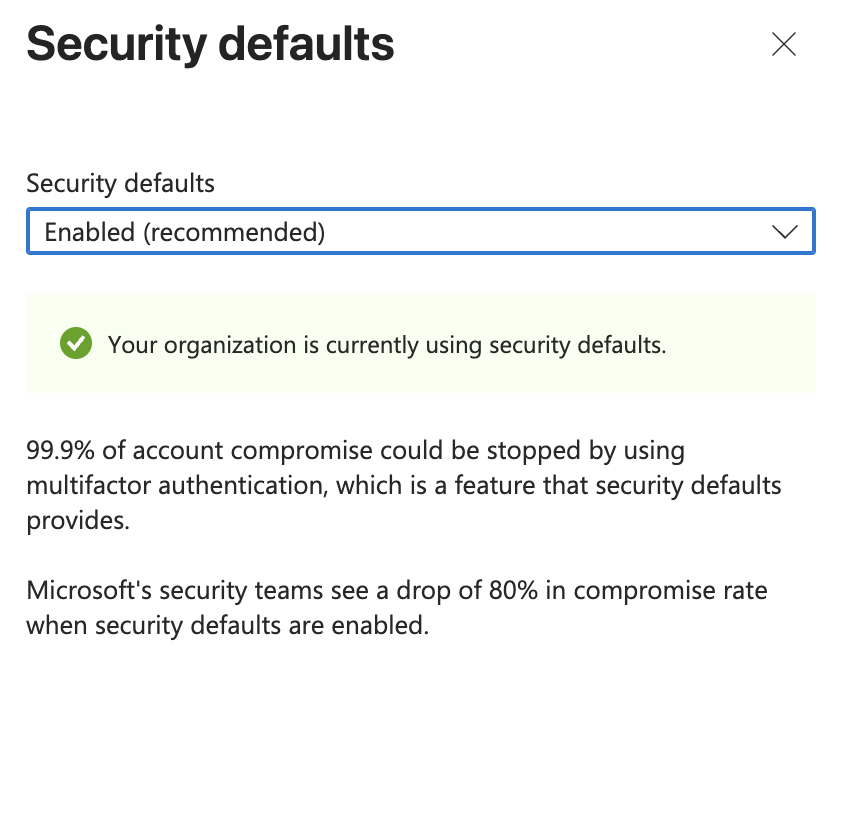
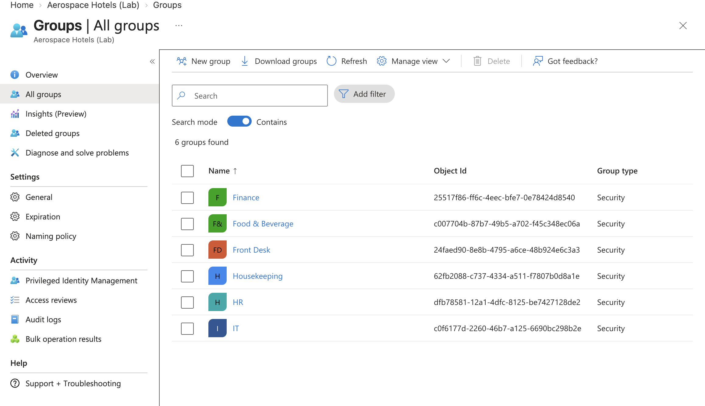

---

## Phase 2: Joiner (New Hire)

**Request:** HR requests an account for new hire **Jasmine Carter, Front Desk Agent**.

**Actions:**
- Created her account with a temporary, auto-generated password
- Set job title, department, company, and usage location
- Added her to the **Front Desk** group for role-based access
- Tested her first sign-in, which required her to set her own password

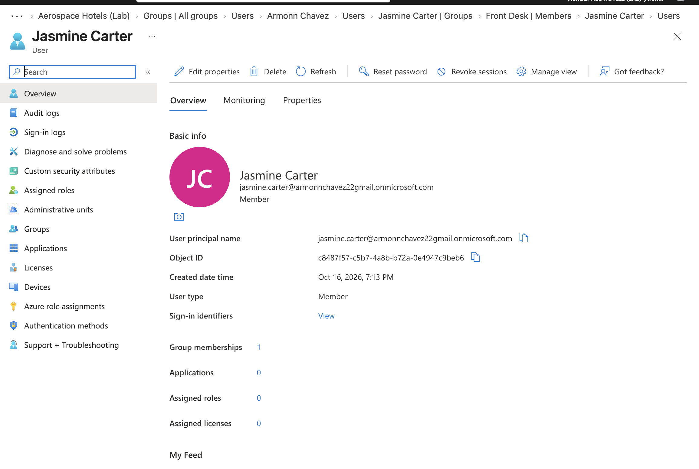
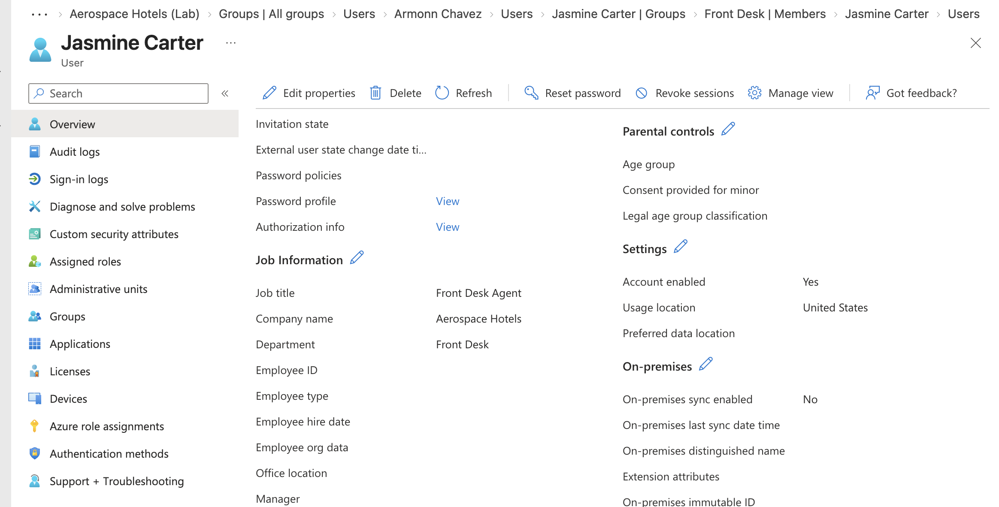
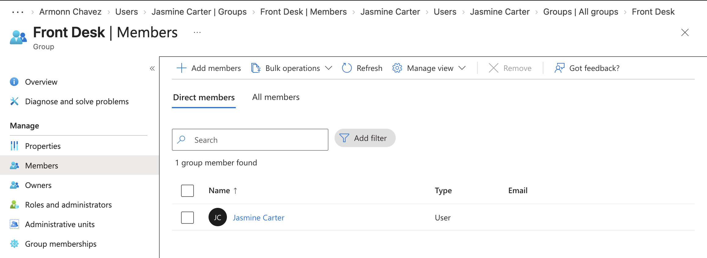
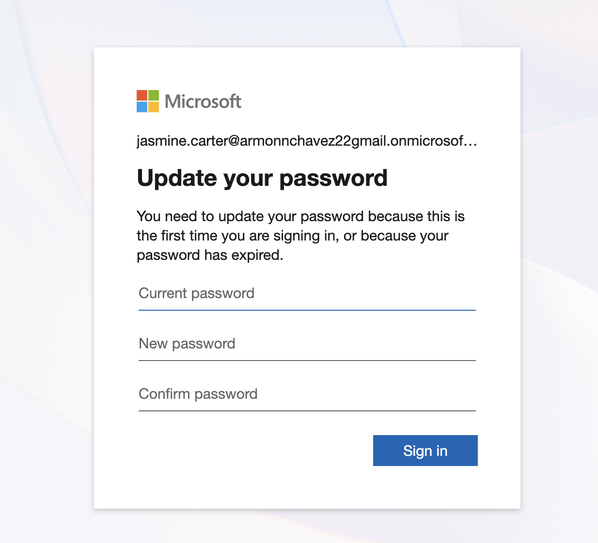
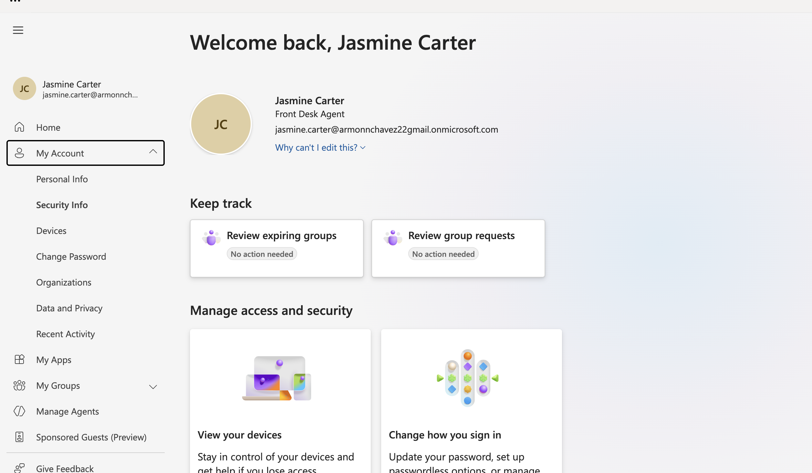

---

## Phase 3: Mover (Role Change)

**Request:** **Luis Ortega**, Front Desk Supervisor, is promoted to **Accounts Payable Specialist** in Finance.

**Actions:**
1. Removed him from **Front Desk** first
2. Added him to **Finance**
3. Updated his job title and department

Removing old access before granting new access follows the **principle of least privilege**, so he never held both departments' access at the same time. The audit log confirms the order of every change.

| Time | Activity |
|---|---|
| 8:13 PM | Add user |
| 8:18 PM | Add member to group (Front Desk) |
| 8:19 PM | Remove member from group (Front Desk) |
| 8:21 PM | Add member to group (Finance) |
| 8:22 PM | Update user (new title and department) |

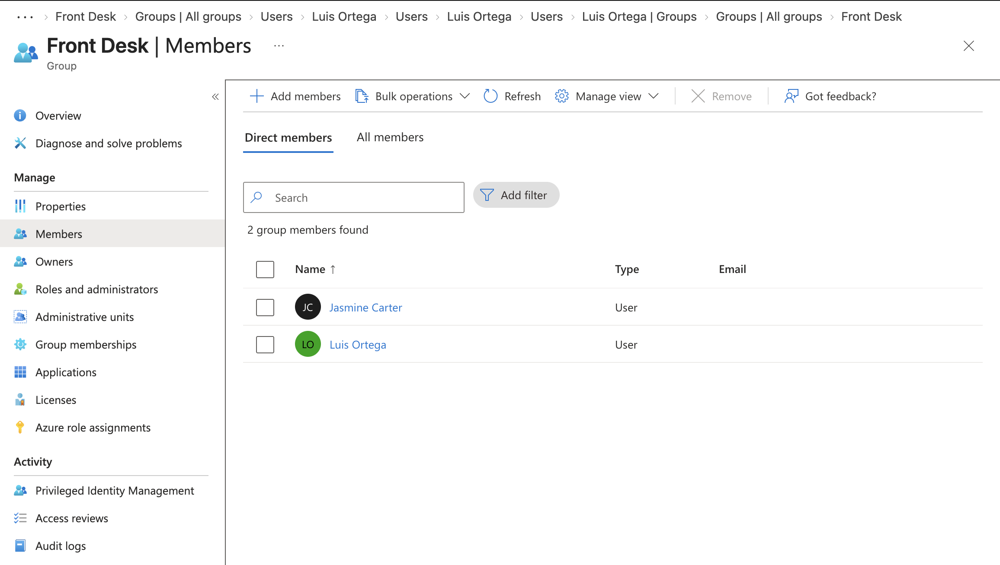
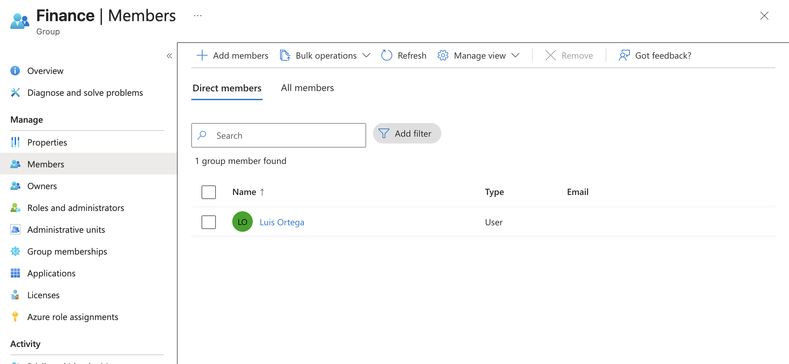
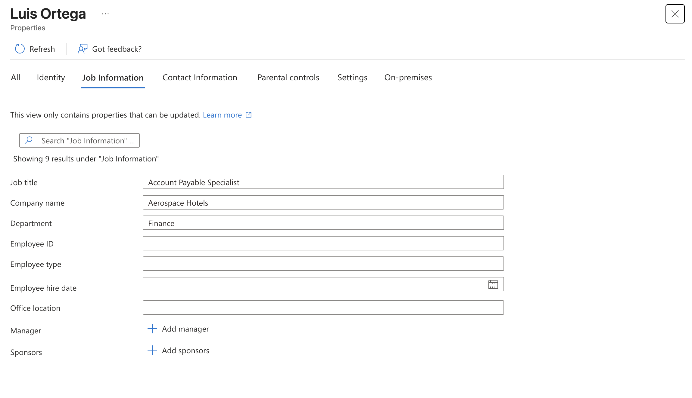
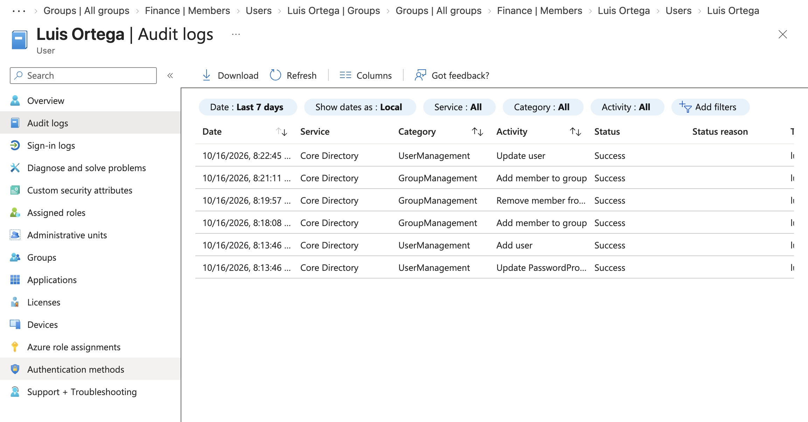

---

## Phase 4: Leaver (Offboarding)

**Request:** **Rachel Kim**, a seasonal Housekeeping Attendant, finishes her contract. HR requests same-day offboarding.

**Actions, in order:**
1. **Blocked sign-in** (account disabled)
2. **Revoked sessions** to sign her out everywhere
3. **Reset her password**
4. **Removed group access** (Housekeeping)
5. **Verified** that her sign-in is blocked

The account was **disabled, not deleted**. Organizations typically keep disabled accounts for a set period so data can be recovered and access history stays available for audits.

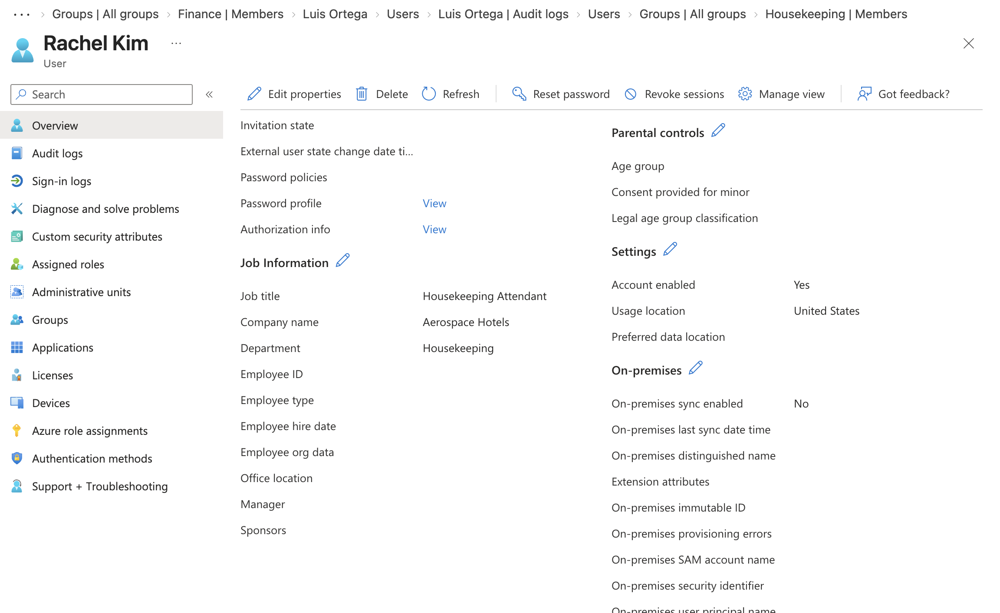
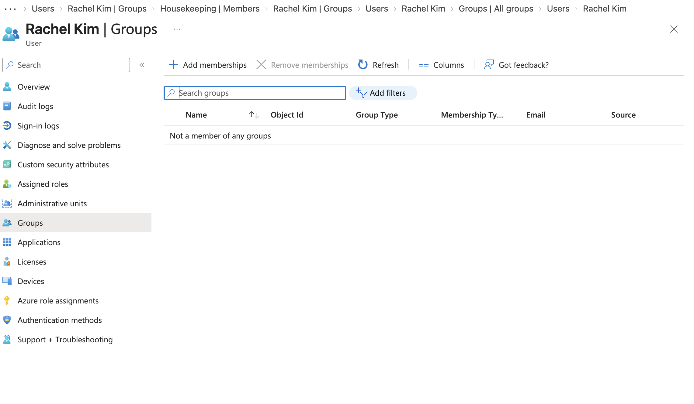
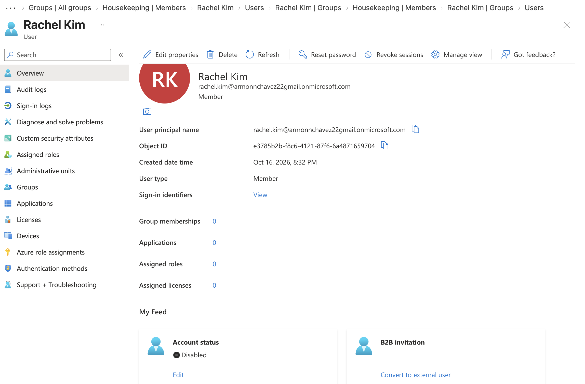
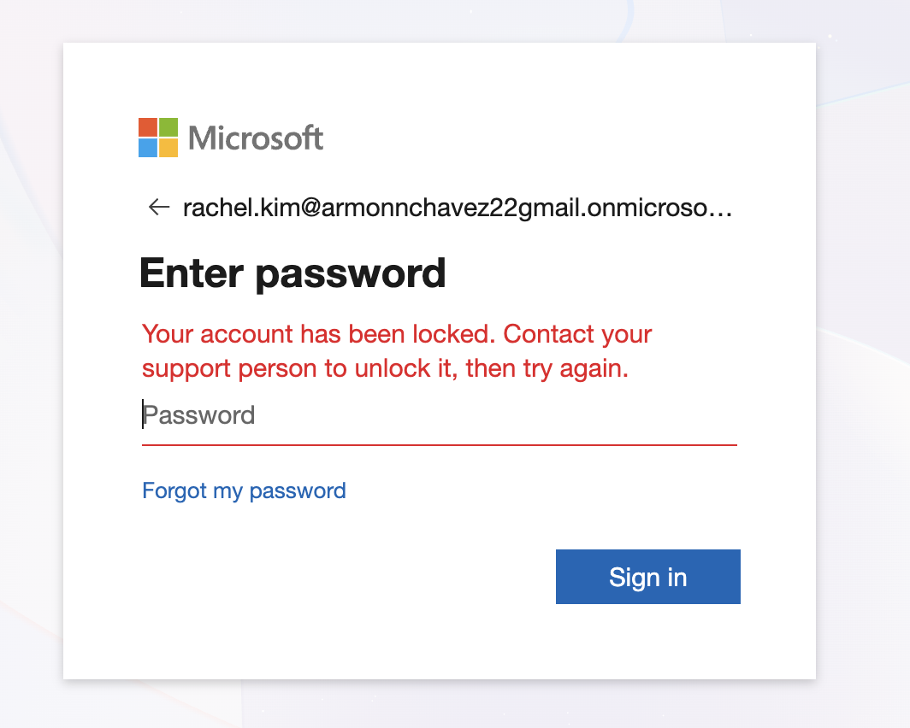
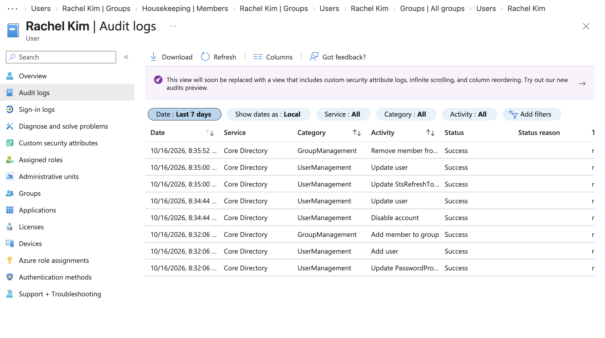

---

## Key Takeaways

- **Access should follow the role.** Group-based access makes onboarding, transfers, and offboarding consistent and easy to audit.
- **Remove before you add.** During role changes, removing old access first prevents permission buildup.
- **Offboarding is time-sensitive.** Disabling the account and revoking sessions right away closes access immediately, including on devices that are already signed in.
- **Document everything.** Audit logs show who changed what and when.
- **Never expose credentials.** No passwords appear in this documentation.
